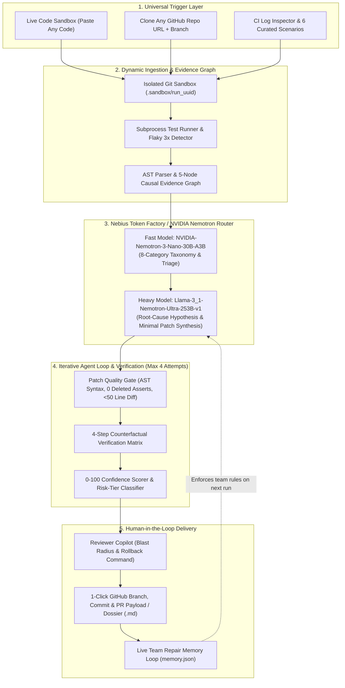

# 🛡️ RepairIQ: Universal Causal CI-Healing & PR Verification Agent

> **An evidence-driven autonomous CI-repair engine powered by NVIDIA Nemotron via Nebius Token Factory.**  
> *RepairIQ doesn't just guess a fix—it investigates, reproduces, verifies causally, enforces strict AST safety gates, and produces confidence-scored, human-approved Pull Requests.*


---

## 🎯 The Problem: Why Developers Don't Trust "Auto-Fix" AI Agents
Standard AI coding agents take a failing log and blindly output a code rewrite. In production engineering, this fails because generic agents:
1. **Hallucinate large diffs** that touch unrelated files.
2. **Cheat to make tests pass** by deleting `assert` statements or wrapping bugs in `except Exception: pass`.
3. **Attempt code fixes on non-code issues** (such as missing environment variables or flaky network timeouts).
4. **Burn expensive reasoning tokens** on trivial triage tasks.

**RepairIQ** solves the **Trust & Verification Gap**. Instead of "logs in, code out," RepairIQ produces an **auditable, verified repair case** with a **0–100 Repair Confidence Score**, a **4-Step Counterfactual Proof Matrix**, and **Risk-Tiered Autonomy**.

---

## ✨ Key Architectural Differentiators

| Feature | What RepairIQ Does | Why It Matters |
| :--- | :--- | :--- |
| **1. Universal Trigger Studio** | Accepts **any arbitrary code** (`Live Code Sandbox`), **clones any GitHub repository URL** (`git clone --depth 5`), or inspects **CI Failure Logs**. | Works dynamically on real-world repositories and custom code—even auto-synthesizing `pytest` suites when none exist. |
| **2. Two-Model Smart Routing (Nebius Token Factory)** | Routes 8-category failure triage & AST extraction to **NVIDIA Nemotron Nano (`NVIDIA-Nemotron-3-Nano-30B-A3B`)** and reserves **Nemotron Ultra (`Llama-3_1-Nemotron-Ultra-253B-v1`)** for deep multi-step code repair. | Cuts inference latency and saves token budget, tracked live in the **Financial Telemetry** panel. |
| **3. Interactive Causal Evidence Graph** | Builds a clickable 5-node causal trace: `Failing Test Assertion` → `Normalized Error Signature` → `Implicated Source File & Line` → `Nemotron Root-Cause Hypothesis` → `Synthesized Minimal Patch`. | Every claim made by the agent is backed by raw clickable evidence (tracebacks, AST nodes, git diffs). |
| **4. 4-Step Counterfactual Verification** | Runs an automated proof loop in an isolated sandbox: **(1) Original Commit Fails** → **(2) Patched Code Passes** → **(3) Full Suite Passes** → **(4) Revert Patch & Confirm Failure Returns**. | Mathematically proves that the proposed patch is the **exact causal fix** for the failure. |
| **5. Static AST & Patch Quality Gate** | Parses candidate diffs with Python's `ast` module to enforce: **Zero Deleted Test Assertions**, **No Broad Exception Swallowing**, **No Secrets/TODOs**, and **Minimal Diff Budget (`<50 lines`)**. | Physically blocks unsafe AI behaviors before they ever reach a Pull Request. |
| **6. Risk-Tiered Autonomy & 0–100 Confidence Scorer** | Scores repairs deterministically (`+25` Reproduced, `+30` Counterfactual Proof, `+20` Minimal Diff, `+15` Static AST Safety, `+10` Team Memory Match; `-60` Penalty for violations). | High-confidence fixes (`85–100`) unlock 1-click PRs; low-confidence or unsafe fixes automatically refuse auto-merge and escalate to humans. |
| **7. Persistent Team Repair Memory** | Stores reviewer conventions and approved/rejected patterns (`memory.json`) and injects matching rules into future Nemotron prompts. | Continuously adapts to a team's specific engineering standards over time. |

---

## 🏗️ System Architecture



---

## 🚀 Quickstart & Local Installation

### Prerequisites
- Python 3.10+
- Git installed and available in system `PATH`
- An API Key from **Nebius Token Factory** (or **NVIDIA NIM** OpenAI-compatible endpoint)

### 1. Clone the Repository
```bash
git clone [https://github.com/YOUR_GITHUB_USERNAME/repair-iq.git](https://github.com/YOUR_GITHUB_USERNAME/repair-iq.git)
cd repair-iq
```

### 2. Create a Virtual Environment & Install Dependencies
```bash
python -m venv .venv
# Windows:
.venv\Scripts\activate
# macOS / Linux:
source .venv/bin/activate

pip install -r requirements.txt
```

### 3. Configure Environment Variables (`.env`)
Create a `.env` file in the root directory (or click the **"Set Nebius API Key"** button directly inside the web dashboard):
```env
NEBIUS_API_KEY=your_api_key_here
NEBIUS_BASE_URL=[https://api.tokenfactory.nebius.com/v1/](https://api.tokenfactory.nebius.com/v1/)
FAST_MODEL_ID=nvidia/NVIDIA-Nemotron-3-Nano-30B-A3B
HEAVY_MODEL_ID=nvidia/Llama-3_1-Nemotron-Ultra-253B-v1
```
*(Note: RepairIQ automatically detects both Nebius Token Factory keys and `nvapi-` NVIDIA endpoints seamlessly).*

### 4. Start the RepairIQ Server
```bash
uvicorn main:app --host 0.0.0.0 --port 8000 --reload
```
Open **`http://localhost:8000`** in your browser.

---

## 🧪 How Judges Can Test RepairIQ in 60 Seconds

1. **Test Any Custom Code (`</> Live Code Sandbox`):**
   - Paste any broken Python code into `Source Code (app.py)` or click one of the Quick-Load buttons (*Missing Env Var*, *Flaky Network Test*, *Real Logic Regression*).
   - Click **"Heal This Failure (Run Agent Loop)"** to watch the 4-agent pipeline reproduce the failure, route between **Nemotron Nano** and **Nemotron Ultra**, verify the patch, and score confidence out of 100.
2. **Clone Any Public GitHub Repository (`Clone GitHub Repo`):**
   - Switch to the **Clone GitHub Repo** tab, paste any GitHub repo URL and branch (`main`), and click **"Clone & Heal Repository"**.
3. **Test the Safety Refusal Gate (`03_assertion_delete_trap`):**
   - Click `03_assertion_delete_trap` in the left gallery to see how RepairIQ catches an unsafe patch that deletes a test assertion, penalizes the confidence score, blocks auto-merge (`ESCALATE ONLY`), and protects the repository.
4. **Teach the Agent a New Rule (`Live Team Memory`):**
   - Type a custom reviewer convention in the bottom bar (e.g., *"Always use explicit type hints on patched functions"*) and click **"Approve & Open PR"**—watch it persist into `LIVE TEAM MEMORY` immediately.

---

## 📄 License
Distributed under the **Apache License 2.0**. See `LICENSE` for more information.